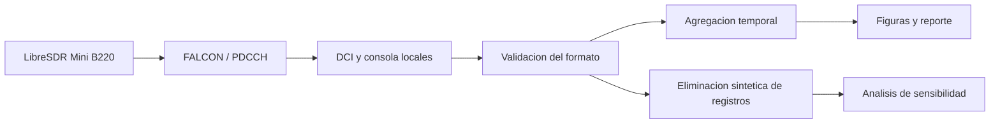
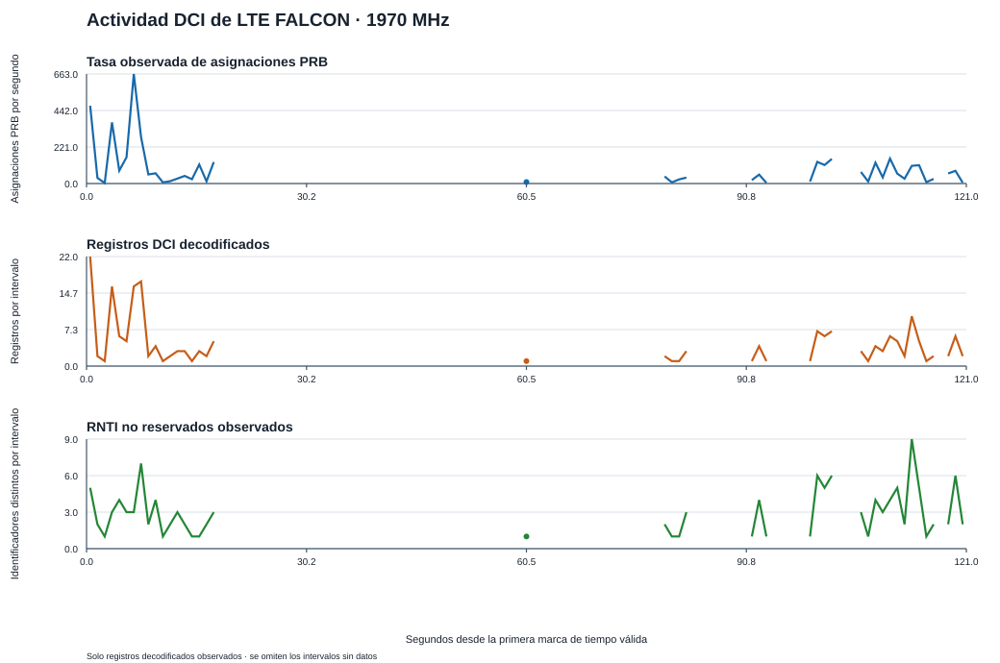
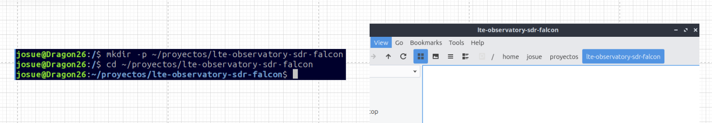
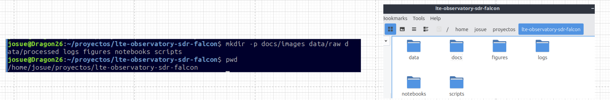
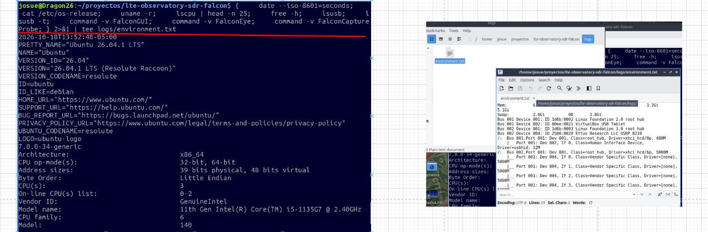
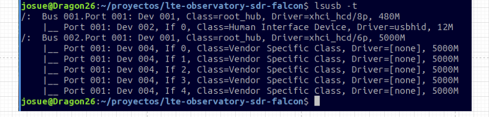
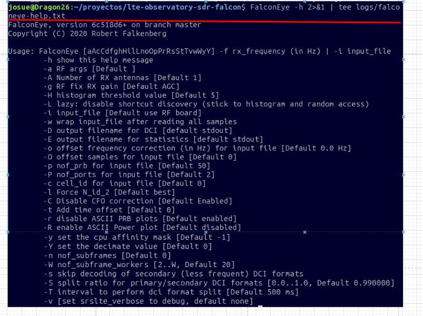
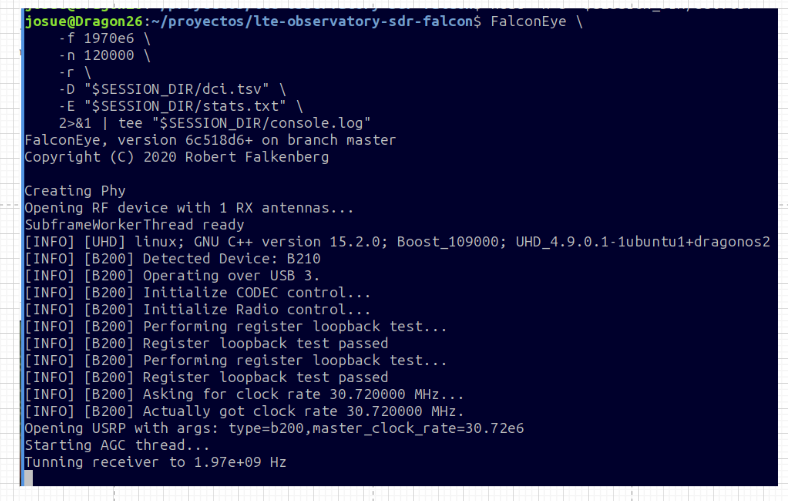
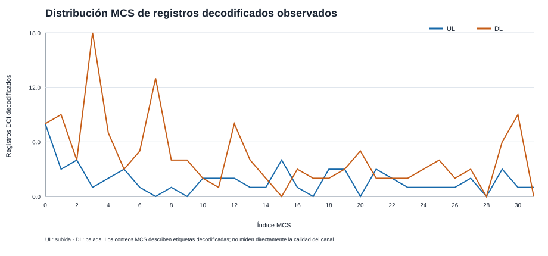
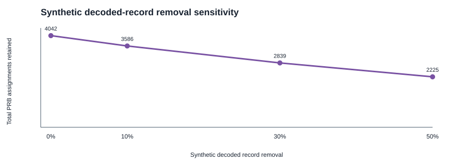

# Observatorio LTE con SDR y FALCON

**Actividad de recursos observada a 1970 MHz y sensibilidad del analisis a registros faltantes.**

Proyecto experimental de Josue Giraldo Moya. Combina recepcion SDR, decodificacion del canal de control LTE mediante FALCON y analisis reproducible en Python. Las figuras y tablas se generan localmente a partir de cada registro; este repositorio no presupone un resultado de recepcion ni una precision demostrada.

## Pregunta experimental

¿Como describir la actividad LTE observada y cuanto cambian sus indicadores cuando faltan registros decodificados?



## Estado y evidencia inicial

Las capturas de pantalla de la sesion piloto muestran:

| Elemento | Evidencia disponible |
|---|---|
| Frecuencia del comando y sintonizacion | 1970 MHz |
| Version declarada por FalconEye | `6c518d6+`, rama master; `+` forma parte de la version mostrada |
| Registros del piloto | `wc -l` reporto 206 lineas; la validez se verifica con el analizador |
| Archivo estadistico | `stats.txt` vacio; consultar `console.log` |
| Metadatos iniciales | Indicaban 2120 MHz por un error de transcripcion; conservar original y registrar la correccion |
| Entorno | VM VirtualBox, 3 CPU visibles, aproximadamente 5.1 GiB RAM total, USB mostrado a 5000M |
| Identificacion del SDR | Etiqueta del montaje LibreSDR Mini B220; UHD lo detecta como B210 |

La tabla documenta evidencia visual. No sustituye el analisis de los archivos originales. Una captura anterior de GUI muestra 14.4547% de subtramas omitidas: no se atribuye ese porcentaje al piloto sin comprobar el registro de su propia sesion.

## Reproduccion

Requisitos: Linux/DragonOS, Python 3.10 o posterior, FalconEye instalado. El analizador utiliza solo la biblioteca estandar; no necesita pip. Las pruebas no requieren SDR.

```bash
python3 -m unittest discover -s tests -v
python3 scripts/analyze.py --help
```

Para el piloto existente:

```bash
python3 scripts/analyze.py \
  --input data/raw/pilot_20261018_140240/dci.tsv \
  --console data/raw/pilot_20261018_140240/console.log \
  --session-label pilot_1970 \
  --frequency-mhz 1970
```

Nueva captura, con GUI cerrada, antena fija y mismo punto:

```bash
bash scripts/capture.sh 1970 120 P01
```

El limite externo de 120 s incluye apertura de radio y busqueda. No equivale a 120 s de senal sincronizada. El script imprime el comando de analisis para esa sesion. Completar `notes.md` antes de comparar sesiones.

## Productos

- `data/processed/<sesion>/`: CSV y resumen JSON agregados, sin listas de RNTI ni contenido hexadecimal DCI.
- `figures/<sesion>/`: graficas SVG de actividad y sensibilidad.
- `docs/results/<sesion>.md`: reporte generado de los resultados reales y advertencias.
- `docs/GUIA.md`: instrucciones para documentar y publicar.

Despues de ejecutar el piloto se podran ver las figuras aqui:



Los enlaces de resultados se incorporan cuando los archivos existen. No se incluyen resultados sinteticos como si fueran mediciones reales.

## Metodo e interpretacion

Se validan las 20 columnas del formato DCI documentado por FALCON. Cada ventana resume asignaciones observadas UL/DL, numero de registros e identificadores distintos con un filtro explicito de valores reservados. Ese filtro es operativo y no identifica de forma exhaustiva los tipos de RNTI. El conteo nunca equivale a personas ni al total de equipos conectados.

Una ventana sin registros tiene actividad desconocida: no se puede distinguir ausencia real de asignaciones de perdida de observacion solo con DCI. La suma de PRB asignados por unidad de tiempo no es un porcentaje de ocupacion validado. Tampoco representa una medicion de velocidad IP ni permite afirmar congestion.

El experimento de sensibilidad elimina aleatoriamente registros DCI de una copia en memoria, con semilla fija. Mide el efecto de datos faltantes sobre los indicadores. No reproduce necesariamente perdidas de subtramas, errores del receptor, interferencia ni degradacion RF. No es un detector de anomalias entrenado ni demuestra exactitud del decodificador.

## Limitaciones

- Las metricas dependen de la decodificacion y pueden contener falsos positivos y omisiones.
- El lapso entre el primer y ultimo registro no mide continuidad de recepcion; los timestamps corresponden al registro del decodificador.
- Las estadisticas de omision del cierre describen una corrida, no cada ventana.
- Una sola sesion piloto no demuestra patrones diarios, fallas de una operadora ni fenomenos geofisicos.
- No se han medido aqui limites absolutos de sensibilidad ni calibrado potencia en dBm.

## Referencias y autoria

- [FALCON: proyecto y formato DCI](https://github.com/falkenber9/falcon).
- [Falkenberg y Wietfeld, FALCON, GLOBECOM 2019](https://arxiv.org/abs/1907.10110).
- [Bucle y estadisticas de FalconEye](https://github.com/falkenber9/falcon/blob/master/src/eye/EyeCore.cc).

FALCON pertenece a sus autores y utiliza AGPLv3. Este proyecto aporta documentacion y scripts externos de analisis; no redistribuye su codigo. El montaje y las capturas son del autor del proyecto. Los scripts de analisis fueron preparados con asistencia de Codex y deben interpretarse junto con sus pruebas y limitaciones.

## Bitacora visual

<details>
<summary>Preparacion del entorno y captura piloto</summary>

### Organizacion del proyecto





### Entorno y conexion del receptor





### Opciones del decodificador



### Captura a 1970 MHz



</details>

## Resultados del piloto procesado

[Informe de resultados](docs/results/pilot_1970.md)

[Resumen JSON](data/processed/pilot_1970/summary.json)

### Distribución MCS



### Sensibilidad a registros faltantes



Las eliminaciones corresponden a registros ya decodificados.
No representan tasas de error medidas en el enlace de radio.
