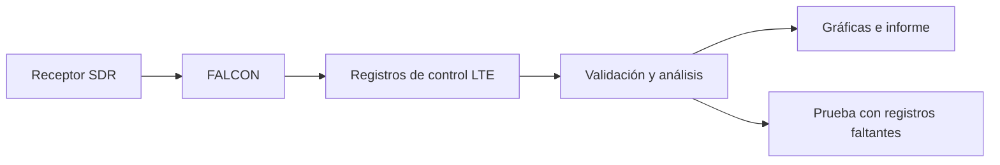
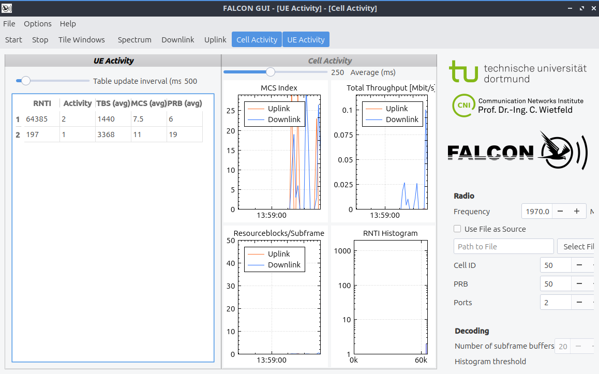

# Observatorio LTE con SDR y FALCON

**Recepción a 1970 MHz, análisis de actividad y evaluación de registros faltantes.**

Este proyecto utiliza un receptor SDR y FALCON para observar mensajes de control de una celda LTE. Un programa en Python organiza esos registros en intervalos de un segundo y genera gráficas para interpretar la medición.

El objetivo es conocer qué se observa y cómo cambian los indicadores cuando faltan datos. Los archivos originales permanecen en el equipo; el repositorio contiene resultados agregados.

## Cómo funciona





## Conceptos para interpretar los datos

| Término | Significado |
|---|---|
| SDR | Receptor cuya señal se procesa mediante software. |
| PDCCH | Canal de control por el que la celda comunica asignaciones de recursos. |
| DCI | Mensaje de control que describe una asignación o instrucción de la red. |
| PRB | Bloque de recursos de radio. Aquí se suman los bloques de las asignaciones observadas. |
| RNTI | Identificador temporal utilizado por LTE. Contarlo no equivale a contar personas. |
| MCS | Índice relacionado con la modulación y codificación de una asignación. |
| UL / DL | Enlace de subida / enlace de bajada. Ambos se estudian a partir del control recibido. |

## Entorno

| Componente | Configuración del piloto |
|---|---|
| Sistema | DragonOS en una máquina virtual VirtualBox |
| Receptor | LibreSDR Mini B220; UHD lo identifica como B210 |
| Frecuencia | 1970 MHz |
| Decodificador | FalconEye `6c518d6+`, rama `master` |
| Análisis | Python 3.10 o posterior, sin bibliotecas adicionales |

## Tutorial

Los comandos se ejecutan en Bash dentro de DragonOS, desde la carpeta del proyecto. Los bloques pueden copiarse directamente.

### 1. Preparar las carpetas

```bash
mkdir -p ~/proyectos/lte-observatory-sdr-falcon
cd ~/proyectos/lte-observatory-sdr-falcon
mkdir -p data/raw data/processed logs figures docs/results
```

Los programas del repositorio deben estar presentes en `scripts/`. La carpeta `data/raw/` se excluye de Git mediante `.gitignore`.

### 2. Comprobar el equipo y las opciones

```bash
cat /etc/os-release
python3 --version
lsusb
lsusb -t
command -v FalconEye
FalconEye -h
```

`lsusb -t` permite revisar la conexión USB del receptor. La ayuda de FalconEye muestra las opciones admitidas por la versión instalada.

### 3. Explorar la señal

```bash
FalconGUI
```

En la interfaz, desmarcar **Use File as Source**, introducir **1970.0 MHz** y pulsar **Start**. Comprobar la recepción y observar las asignaciones. Al terminar, pulsar **Stop** y cerrar la interfaz para liberar el receptor.

Los valores predeterminados de la interfaz no sustituyen los parámetros confirmados durante la adquisición.

### 4. Registrar una sesión

```bash
bash scripts/capture.sh 1970 120 P01
```

Los argumentos indican frecuencia en MHz, límite total de tiempo en segundos y etiqueta del punto de medición. `P01` permite comparar sesiones tomadas en el mismo lugar.

El programa guarda `dci.tsv`, `console.log`, `metadata.txt`, `stats.txt` y una plantilla `notes.md` dentro de una carpeta nueva en `data/raw/`. Completar la plantilla con la antena, orientación y condiciones de la sesión.

El límite de 120 segundos incluye la apertura del receptor y la búsqueda de celda. No garantiza 120 segundos de señal sincronizada. Al alcanzar ese límite, `timeout` puede devolver el código 124; revisar el cierre en la consola.

### 5. Revisar y analizar el piloto

Para reproducir el análisis de la sesión utilizada en este repositorio:

```bash
PILOT_DIR="$PWD/data/raw/pilot_20261018_140240"

ls -lh "$PILOT_DIR"
wc -l "$PILOT_DIR/dci.tsv"

python3 scripts/analyze.py \
    --input "$PILOT_DIR/dci.tsv" \
    --console "$PILOT_DIR/console.log" \
    --session-label pilot_1970 \
    --frequency-mhz 1970 \
    --window 1
```

La ruta corresponde a un archivo local y no se distribuye en el repositorio. Para otra sesión, cambiar la carpeta de entrada y la etiqueta de salida. El programa de captura imprime el comando correspondiente al terminar.

El analizador comprueba la cantidad de campos y valores clave. Las filas inválidas se contabilizan y se excluyen de las gráficas. Si no hay registros válidos, el análisis termina con un error.

### 6. Abrir las gráficas y el informe

```bash
xdg-open figures/pilot_1970/activity.svg
xdg-open figures/pilot_1970/mcs.svg
xdg-open figures/pilot_1970/synthetic_record_removal.svg
cat docs/results/pilot_1970.md
```

### 7. Comprobar el programa

```bash
python3 -m unittest discover -s tests -v
```

Las pruebas utilizan datos sintéticos y comprueban el procesamiento. No requieren SDR ni demuestran por sí solas la exactitud de la recepción.

## Resultados del piloto

El [resumen publicado](data/processed/pilot_1970/summary.json) contiene:

| Indicador | Resultado |
|---|---|
| Registros válidos | 198 |
| Filas descartadas | 9; una con cantidad de campos incorrecta |
| Lapso entre el primer y último registro válido | 120,542 segundos |
| Suma de PRB de las asignaciones observadas | 4042 |
| Identificadores distintos tras el filtro operativo | 45 |
| Ventanas de un segundo con registros | 44 |

Estas cifras describen lo decodificado. El lapso temporal no demuestra recepción continua y el conteo de identificadores no representa usuarios únicos.

### Figura 1. Actividad observada en el tiempo


La figura tiene tres paneles:

- **Asignaciones de PRB:** suma los bloques de las asignaciones observadas y los expresa por segundo. Un pico indica más recursos registrados en ese intervalo.
- **Registros DCI:** cuenta los mensajes decodificados dentro de cada ventana.
- **RNTI observados:** cuenta identificadores distintos después del filtro descrito en el informe.

Los espacios sin trazado indican ventanas sin registros. No se rellenan con cero porque no sabemos si faltó actividad, recepción o decodificación. La primera curva no es un porcentaje de ocupación de la celda ni una medición de velocidad de Internet.

### Figura 2. Distribución de MCS


El eje horizontal muestra los índices MCS y el vertical cuántos registros presentan cada índice. Las dos curvas separan subida y bajada.

La figura permite comparar qué índices aparecen con mayor frecuencia. Por sí sola no determina la calidad del canal ni el rendimiento de una conexión. Algunos índices tienen interpretaciones especiales que dependen del formato y contexto LTE.

### Figura 3. Sensibilidad a registros faltantes


Se elimina aleatoriamente una parte de los registros ya decodificados, con probabilidades del 10 %, 30 % y 50 %. El escenario del 0 % conserva la referencia original. Una semilla fija permite repetir la misma selección.

El eje vertical muestra cuántas asignaciones de PRB permanecen en cada escenario. La comparación ilustra cuánto puede cambiar el indicador cuando faltan datos. La fracción efectivamente eliminada puede diferir de la probabilidad indicada, especialmente en muestras pequeñas.

Esta prueba modifica registros de una copia en memoria. No reproduce directamente pérdidas de subtramas, interferencia ni fallas reales del receptor. Es una exploración de sensibilidad con una sola semilla, no una validación de precisión ni un detector de anomalías.

## Archivos de resultados

| Archivo | Contenido |
|---|---|
| [Informe](docs/results/pilot_1970.md) | Resultados, método y advertencias. |
| [Resumen JSON](data/processed/pilot_1970/summary.json) | Indicadores de la sesión. |
| [Actividad por ventana](data/processed/pilot_1970/activity.csv) | Asignaciones UL/DL, mensajes e identificadores agregados. |
| [Distribución MCS](data/processed/pilot_1970/mcs_distribution.csv) | Conteos de cada índice en ambos sentidos. |
| [Experimento de registros faltantes](data/processed/pilot_1970/synthetic_record_removal.csv) | Valores de cada escenario sintético. |

## Alcance y limitaciones

El piloto demuestra un procedimiento reproducible para organizar y visualizar registros DCI. La información obtenida depende de la recepción y del decodificador, por lo que puede contener omisiones y falsos positivos.

El filtro de identificadores excluye el valor 0 y los valores desde 65524. Es un filtro operativo, no una clasificación completa de todos los tipos de RNTI. El archivo DCI tampoco permite separar por sí solo baja actividad y falta de observación.

En esta sesión no se extrajo un resumen reconocible de subtramas omitidas desde la consola. Por tanto, no se asigna un porcentaje de omisión al piloto. Un `stats.txt` vacío no demuestra ausencia de errores: hay que revisar `console.log`.

Como ampliación, se propone repetir las mediciones en diferentes horarios manteniendo el mismo montaje y evaluar los métodos con más sesiones y realizaciones aleatorias.

## Referencias

- [FALCON: documentación y formato de registros](https://github.com/falkenber9/falcon).
- [Artículo de FALCON, GLOBECOM 2019](https://arxiv.org/abs/1907.10110).
- [Código de adquisición de FalconEye](https://github.com/falkenber9/falcon/blob/master/src/eye/EyeCore.cc).

FALCON se distribuye bajo AGPLv3. Este repositorio incorpora scripts externos de análisis y documentación; no redistribuye el código de FALCON.
